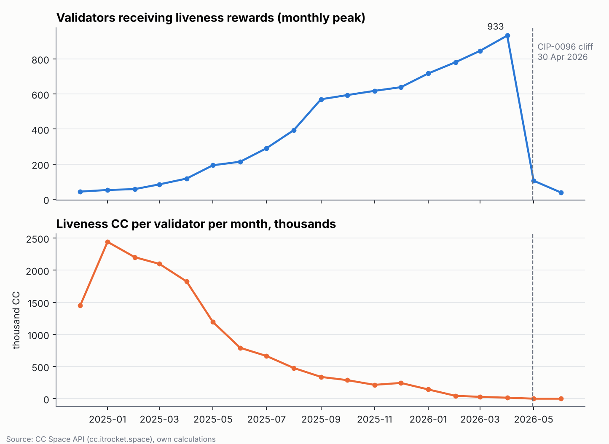
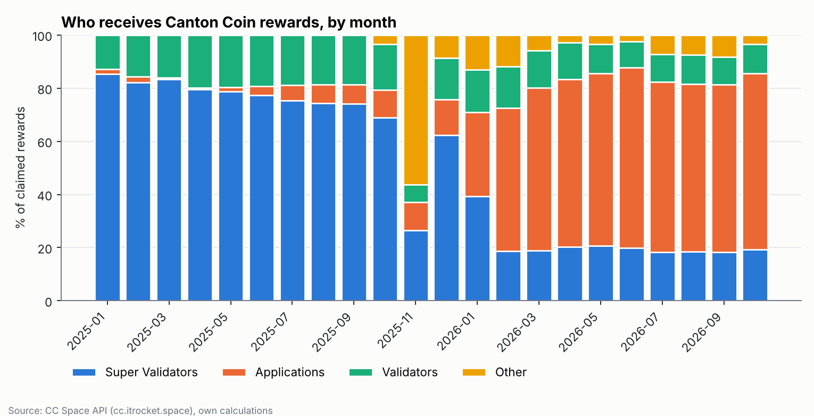
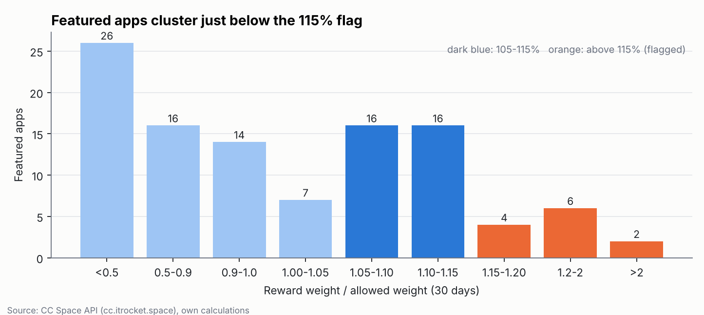
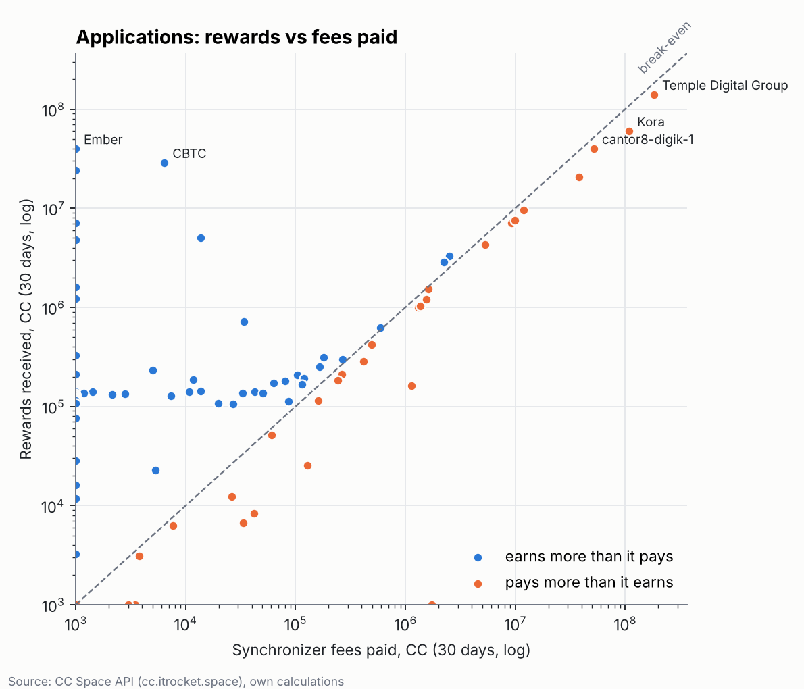
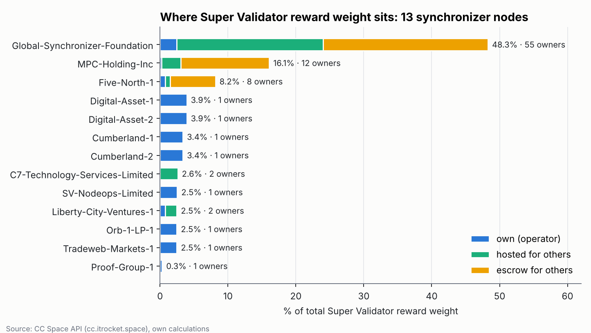

# Who earns on Canton after the liveness rewards ended

An on-chain data analysis of how the Canton Network distributes Canton Coin (CC) rewards
between Super Validators, validators and applications, before and after the
1 January 2026 halving and CIP-0096 (end of validator liveness rewards, 30 April 2026).

Data: [CC Space API](https://cc.itrocket.space), pulled on 6 November 2026.

## Key findings

| Finding | Number |
|---|---|
| Liveness CC per validator per month | ~1.8M CC (Apr 2025) → ~15K CC (Apr 2026), before the cliff |
| Active validators today vs liveness recipients at peak | 859 vs 933 |
| Applications' share of claimed rewards | 6% (2025) → 65% (Jun–Oct 2026) |
| Super Validators' share of claimed rewards | 66% (2025) → 19% (Jun–Oct 2026) |
| Applications, last 30 days: rewards vs fees paid | 424M CC vs 436M CC |
| Featured apps at 105–115% of their reward allowance (flag at 115%) | 32 of 107 |
| Approved featured apps short of the CIP-0116 lock | 17 of 135 (110M CC total); 49 more registry entries paused under CIP-0116 |
| Super Validator reward weight on the largest node | 48% (votes are one per node) |

1. **The liveness cliff was a non-event.** Liveness pay per validator had already fallen by over 99% before CIP-0096 switched it off.
2. **The real shift was the January 2026 halving.** Applications overtook Super Validators as the main reward recipients in January–February 2026.
3. **Large applications pay their way; the long tail sits on a quota floor.** 27 small apps earn ~135K CC a month each with almost no fees.
4. **The rules shape behaviour.** Featured apps cluster just under the 115% compliance flag.
5. **Governance is spread, hosting is not.** 85 parties own SV reward rights, but half of that weight is hosted on one of 13 nodes.







## Project structure

```
fetch.py            download data from the CC Space API (12 requests, cached)
analyze.py          compute all numbers, tables and charts from data/raw
main.py             Super Validator weights announced in CIPs (data/sv_cips.csv)
src/client.py       API client: auth from .env, on-disk cache, hard call budget
src/jobs.py         which endpoints are downloaded and why
src/analysis.py     tidy tables and headline numbers
src/charts.py       article charts
src/metrics.py      concentration metrics: HHI, top-k share, Nakamoto coefficient, Gini
tests/              hand-checked metric tests
data/raw/           raw API responses (created by fetch.py, not committed)
outputs/            headline.json, tables/*.csv, charts/*.png
```

## Reproduce

Requires Python 3.12. The raw API responses are not included in this repository;
the computed tables and charts are in `outputs/`. To rebuild everything from scratch
you need a free [CC Space](https://cc.itrocket.space) API key (12 requests = 12 credits):

```
pip install -r requirements.txt
copy .env.example .env         # then put your key into .env
python fetch.py --dry-run      # shows the 12 requests, spends nothing
python fetch.py                # downloads into data/raw, only what is not cached yet
python analyze.py              # rebuilds outputs/ from data/raw
```

Run the tests with `python -m pytest tests`.

## Limitations

- Liveness snapshots in the API end on 27 June 2026.
- The data does not show when stale validators went stale.
- November 2025 includes a one-off distribution of ~1.6B CC of unclaimed rewards (CIP-0066/0067).
- Super Validator reward weight is not voting power: governance votes are one per SV node.
- Super Validator weights in `data/sv_cips.csv` are taken from CIP titles and are announced, not actual, weights.

## Sources

- [CC Space API](https://cc.itrocket.space)
- [Canton CIP repository](https://github.com/canton-foundation/cips)
- [CIP-0116: Featured App Locking](https://github.com/canton-foundation/cips/blob/main/cip-0116/cip-0116.md)
- [SV governance reference](https://docs.canton.network/overview/reference/sv-governance-reference.md)
- [Tokenomics of the Global Synchronizer](https://docs.canton.network/overview/reference/tokenomics-of-gs.md)

## Author

Denis Kramskyi · [LinkedIn](https://linkedin.com/in/denis-kramskyi) · [GitHub](https://github.com/DeniKram)


